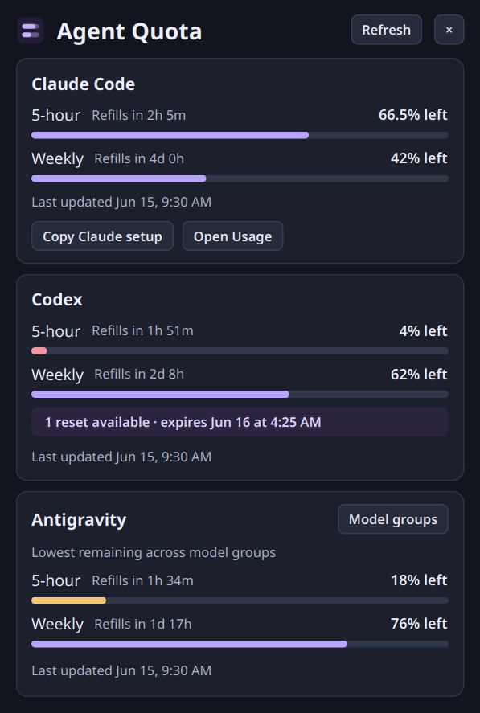

# Agent Quota

A Linux tray app for the five-hour and weekly quotas of Claude Code, Codex, and
Google Antigravity. Each limit shows its remaining percentage and refill time.
Codex also shows redeemable resets and sends one desktop alert per confirmed
reset within 24 hours of expiry.



*Demo data.*

## Open the app

Agent Quota is tested on Ubuntu GNOME. Install Python 3.12 and `uv`, and sign
in to the agent CLIs you want to monitor. Desktop expiry alerts use `notify-send`.

```sh
git clone https://github.com/MHkhosravi/agent-quota.git
cd agent-quota
uv sync --locked
uv run agent-quota install-launcher
uv run agent-quota
```

After installing the launcher, open **Agent Quota** from Activities. On Ubuntu
GNOME, double-click the tray icon or select **Open Agent Quota** from its menu.
The same menu offers **Refresh**, **Start at login**, and **Quit**.

Codex and Antigravity use their existing CLI sign-ins and refresh on launch and
every five minutes. The last successful reading remains visible when a provider
is temporarily unavailable. Quota bars age independently after their scheduled
refill.

## Connect Claude Code

Select **Copy Claude setup** in the popup and merge the copied `statusLine`
entry into the JSON object in `~/.claude/settings.json`. Create the file if
needed. Claude sends the quota data after it receives an API response during a
normal conversation. **Open Usage** opens Claude's redeemable reset offers.

The copied setup preserves an existing user status line. If a project overrides
your status line, use the copied absolute helper path with
`capture-claude --then '<existing command>'` in the project settings. The helper
forwards the original input and displays the original command's output.

Normalized quota snapshots and alert history live under
`${XDG_STATE_HOME:-~/.local/state}/agent-quota`. The app uses the public
CLI interfaces to collect status and stores the supplied quota fields locally.

## Checks

```sh
uv run pytest
uv run ruff check
uv run ruff format --check
uv run ty check
```

## License

Agent Quota is available under the [MIT License](LICENSE).
